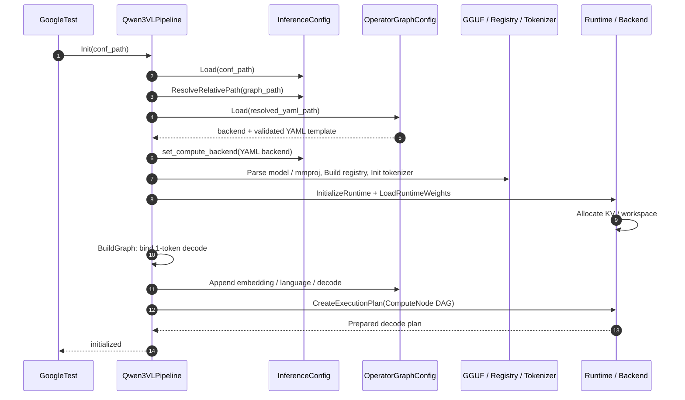
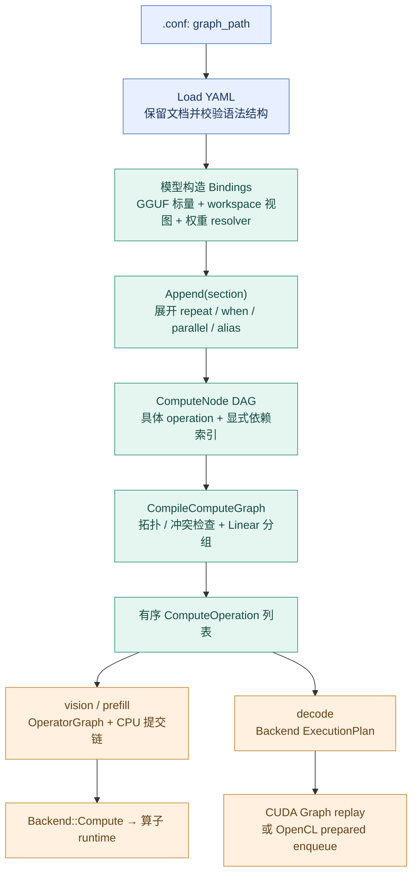
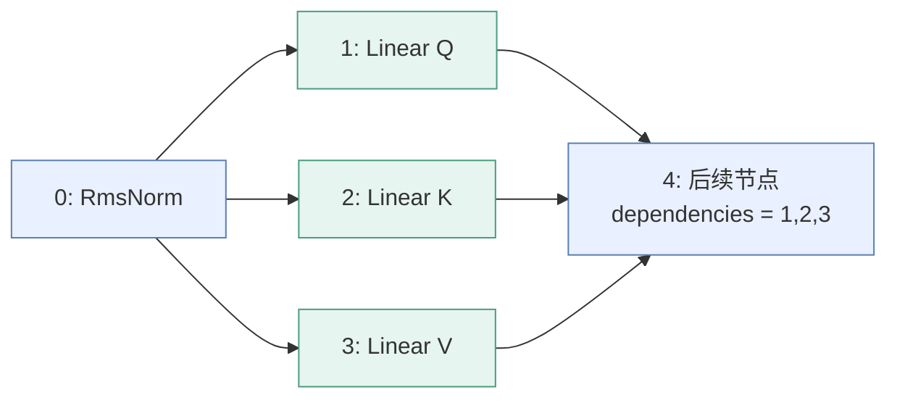
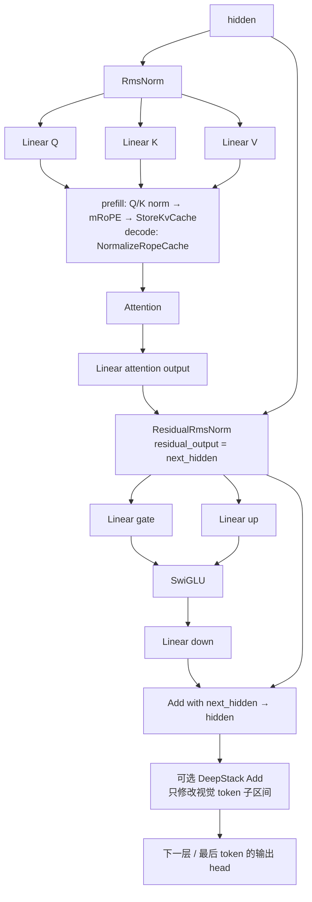
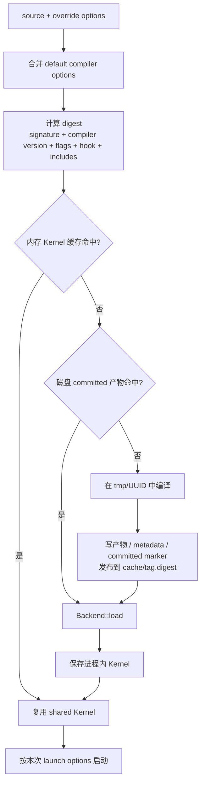

# Omni-Runtime 架构与配置驱动推理技术报告

> **主题**：模块分层、Qwen3-VL 端到端执行、YAML 算子图构造，以及 CUDA/OpenCL JIT 编译系统。
>
> **源码基线**：2026-10-24 工作区，HEAD `e133b86`。
> 本文根据当前源码分析，不以历史 executor 架构代替现有实现，也不将设计目标写成已实现能力。
> 本次交付仅增加文档和架构图，未重新执行模型推理或性能测试。

## 阅读导航

1. [整体架构与设计原则](#architecture)
2. [各模块的职责与设计](#modules)
3. [以 Qwen3-VL 测试为例的完整执行链路](#qwen3-vl-execution)
4. [重点：YAML 如何变成可执行计算图](#yaml-graph)
5. [内核编译系统：kernel、cuda_jit 与 opencl_jit](#jit-compilation)
6. [后端隔离、扩展方法与工程边界](#backend-boundaries)
7. [复现命令与源码索引](#reproduction)

---

<a id="architecture"></a>

## 1. 整体架构与设计原则

### 1.1 一句话理解 Omni-Runtime

**Omni-Runtime 将模型业务语义、算子计算契约、设备资源管理和平台执行机制分离，
使用公共算子描述承接模型图，再由 CUDA/OpenCL 后端执行同一组模型语义。**

对于当前 Qwen3-VL 路径，可以用下面的等式理解：

```text
模型推理
  = .conf 中的运行资源配置
  + YAML 中的算子结构模板
  + GGUF 中的模型维度与权重
  + 模型代码中的形状/内存/生成语义绑定
  + 后端中的计算实现与执行计划
```

YAML 并没有取代模型适配层；它取代的是原来手写在模块级 executor 内部的大量算子编排。
例如，模型代码仍然需要知道如何展开图像占位 token、构造 mRoPE 位置、
选择每层 KV cache 切片，但不再在 C++ 中重复写整套 attention/FFN 算子调用顺序。

### 1.2 模块分层架构图


原图：[可独立打开的 SVG 架构图](images/omni_runtime_layered_architecture.svg)。
SVG 不依赖 Mermaid 插件；后续流程图使用 Mermaid，需阅读器支持。

图中展示的是**逻辑分层与主要运行路径**，不是严格单向的源码依赖图：

- 模型层使用公共推理、内存和 backend 接口。
- backend 的具体实现使用算子 runtime 和 JIT 服务。
- 算子 runtime 引用 backend 的公共计算描述，而不是引用模型层。
- `graph`、`memory`、GGUF 解析、工具库构成横向支撑。
- CUDA BLAS 是一条后端自有执行路径，不要求所有矩阵乘都经过自定义 JIT kernel。

### 1.3 最重要的三个“图”

| 图的层次 | 主要表示 | 节点是什么 | 作用 |
|---|---|---|---|
| 算子语义图 | `vector<backend::ComputeNode>` | `ComputeOperation` 与前驱索引 | 表达数学算子及依赖，供公共编译器校验、分组 |
| CPU 提交图 | `graph::Pipeline`、`ComputeOperatorNode` | 调用 `Backend::Compute()` 的 CPU 节点 | vision/prefill 使用，管理提交顺序、生命周期及错误 |
| 后端执行计划 | `backend::ExecutionPlan` | CUDA Graph 或 OpenCL 预绑定 kernel 序列 | decode 重复执行，降低每 token 的主机组织开销 |

**不能把 `ComputeNode`、`graph::Node` 和 CUDA Graph node 当成同一种对象。**
YAML 最先生成的是算子语义图；后续可以生成 CPU 提交图，也可以直接生成后端执行计划。

### 1.4 主要设计原则

1. **业务无平台 API**：模型代码传递 `DeviceView`，不解释 CUDA 指针或 `cl_mem`。
2. **结构与实例分离**：YAML 描述模板，GGUF 与请求 shape 决定实际参数。
3. **数学契约先于实现**：公共 `Attention` 不直接暴露 FA4、分区数或 OpenCL entry。
4. **资源常驻、按请求绑定**：权重、KV 和主要 workspace 在初始化时分配；
   请求阶段根据实际 token 数绑定已分配内存。
5. **重复热路径专门准备**：decode 是单 token 图，适合常驻计划；动态 vision/prefill 保留按 shape 构图。
6. **配置错误显式失败**：不把无效 YAML、未知算子或指定后端不可用转成成功或静默跨平台回退。

<a id="modules"></a>

## 2. 各模块的职责与设计

### 2.1 总体模块表

下列目录均相对于仓库根目录。

| 模块 | 主要职责 | 关键设计 | 不负责的事情 |
|---|---|---|---|
| [graph](../Omni-Runtime/graph/) | CPU DAG、生命周期和任务调度 | `Pipeline` / `Element` / `Node`，拓扑批次、线程池、Status | 不编译 GPU 源码，不管理模型权重 |
| [inference](../Omni-Runtime/inference/) | 公共推理组件与算子图装配 | 配置、tokenizer、图像输入、文本流、`OperatorGraphConfig` | 不解释设备原生句柄 |
| [models](../Omni-Runtime/models/) | 模型适配与推理业务 | 权重注册、shape/workspace 绑定、位置/KV/生成状态 | 不实现 CUDA/OpenCL 原生提交 |
| [backend](../Omni-Runtime/backend/) | 计算契约、设备服务与执行计划 | `Backend`、操作 variant、计算图编译、CUDA/OpenCL 实现 | 不决定 chat template 或 DeepStack 模型语义 |
| [memory](../Omni-Runtime/memory/) | 内存所有权、张量和传输封装 | `Buffer`、`Tensor`、切片视图、stream/event RAII | 不决定算子顺序 |
| [kernel](../Omni-Runtime/kernel/) | 通用 JIT 运行与编译辅助设施 | Runtime 模板、依赖哈希、内存/磁盘缓存 | 不是数学算子库 |
| [kernels](../Omni-Runtime/kernels/) | 数学算子及平台参数适配 | CUDA `.cuh`、OpenCL `.cl`、对应 runtime | 不加载模型业务配置 |
| [gguf_serializer](../Omni-Runtime/gguf_serializer/) | GGUF 格式解析与权重读取 | 元数据/tensor 索引、类型与字节布局校验 | 不直接执行神经网络 |
| [utils](../Omni-Runtime/utils/) | 基础支撑 | 日志、返回状态宏、线程池 | 不承载模型数学定义 |
| [example](../example/)、[script](../script/) | 用例、编译与测试入口 | GoogleTest、Bazel runfiles、统一脚本 | 不是另一套推理 runtime |

### 2.2 graph：通用 CPU DAG 与生命周期

主要入口为 [pipeline.h](../Omni-Runtime/graph/pipeline/pipeline.h)，
调度实现集中于 [element_manager.cc](../Omni-Runtime/graph/element/element_manager.cc)。

#### 2.2.1 对象结构

- `Element`：统一依赖关系、状态和生命周期处理。
- `Node`：承载具体执行动作。
- `Group`：组合多个子元素，支持串行组合、条件选择、区域子图等。
- `Pipeline`：注册元素、创建执行上下文，组织 `Init → Run → Destroy`。
- `ElementManager`：校验依赖、产生拓扑批次并执行元素。
- `PipelineFactory`：创建和回收 pipeline；不要把它与模型 backend 工厂混淆。

`ElementManager::Run()` 先取得拓扑批次。如果执行策略允许、当前不是线程池 worker，
且批次内有多个元素，会把该批任务交给线程池并等待；否则顺序执行。
因此，它是 CPU 任务依赖调度器，不是自动将每个节点映射到独立 GPU stream 的调度器。

#### 2.2.2 横向扩展能力

| 子模块 | 设计用途 | 与当前 Qwen3-VL 路径的关系 |
|---|---|---|
| `param` | 管理共享参数、传参对象及访问追踪 | 提供通用图能力，不等于 YAML binding 字典 |
| `aspect` | 生命周期前后钩子，处理运行、异常、超时等横切逻辑 | 可用于观测扩展，不是 GPU profiling event |
| `event` | 命名事件与同步/异步触发策略 | CPU 图事件，不等于 CUDA/OpenCL event |
| `stage` | 带阈值和代际状态的同步屏障 | 用于任务协调，不是 Transformer layer |
| `daemon` | 周期性后台任务 | 不是常驻 decode 执行计划 |
| `message` | 消息连接和等待/替换/丢弃策略 | 不负责设备 tensor 的隐式搬运 |
| `pipeline/storage` | 图对象保存、恢复等基础设施 | 与读取模型 YAML 是两条不同路径 |

当前 `OperatorGraph::Prepare()` 使用 `InferenceGraph` 创建 **1 个线程的串行算子提交链**。
即使底层 `graph` 支持并行，也不能据此认定 Qwen3-VL 的 YAML 分支会以多 CPU 节点并行提交。

### 2.3 inference：公共推理设施

#### 配置

[InferenceConfig](../Omni-Runtime/inference/common/inference_config/inference_config.h)
处理 `key=value` 格式，负责配置文件目录与相对路径解析。
其内容是运行参数，不是计算图。`graph_path` 将运行配置与算子结构关联起来。

#### Tokenizer 与模板

[GGUFTokenizerLoader](../Omni-Runtime/inference/tokenizer/gguf_tokenizer_loader.h)
从 GGUF 加载词表等 tokenizer 数据；
[TokenizerFactory](../Omni-Runtime/inference/tokenizer/tokenizer_factory.cc)
按类型创建 BPE、WordPiece 或 Unigram 实现。
[chat_template.cc](../Omni-Runtime/inference/tokenizer/chat_template.cc)
构造模型要求的角色边界和视觉占位符。

#### 图像公共处理

[ImagePreprocessor](../Omni-Runtime/inference/common/image_preprocessor/image_preprocessor.cc)
负责在 CPU 上解码 RGB、计算满足 patch/merge 对齐的网格。
真正的 resize、归一化和 patch 数据整理继续由 YAML 的 `ImagePatchPreprocess`
及其底层算子实现完成，而不是全部在 CPU 解码器内执行。

#### 文本流

[TextStream](../Omni-Runtime/inference/common/text_stream/text_stream.cc)
缓冲不完整 UTF-8 字节，向回调发送完整文本片段；回调返回 `false` 表示取消，
抛出的异常会记录错误并返回失败。因此一个 token 不一定正好对应一次回调。

#### 算子图装配

[OperatorGraphConfig](../Omni-Runtime/inference/inference_graph/operator_graph.cc)
读取 YAML、展开控制结构、绑定字段，输出公共 `ComputeNode`。
[OperatorGraph](../Omni-Runtime/inference/inference_graph/operator_graph.h)
把编译后的操作装配为 `InferenceGraph` 中的 CPU 节点。

这里有两个容易误读的地方：

- [sampling](../Omni-Runtime/inference/sampling/sampler.cc) 提供通用 CPU greedy sampler，
  但本报告中的 Qwen3-VL 走 YAML `Argmax`，不是把全部 logits 拷回 CPU 再采样。
- [executor](../Omni-Runtime/inference/executor/) 目前文件为空，是占位目录；
  不能将 `ModelExecutor` 描述成已经参与当前推理的统一执行层。

### 2.4 models/qwen3_vl：模型知识与运行状态

| 文件 | 主要内容 |
|---|---|
| [qwen3_vl_pipeline.cc](../Omni-Runtime/models/qwen3_vl/qwen3_vl_pipeline.cc) | 初始化入口、配置/权重/tokenizer 加载、请求检查、生成总流程 |
| [qwen3_vl_graph.cc](../Omni-Runtime/models/qwen3_vl/qwen3_vl_graph.cc) | YAML bindings、每层 KV 切片、DeepStack 绑定、decode 构图和 vision 执行 |
| [qwen3_vl_generation.cc](../Omni-Runtime/models/qwen3_vl/qwen3_vl_generation.cc) | prompt 与 mRoPE 位置、prefill、视觉 embedding 注入、decode 循环、文本流 |
| [qwen3_vl_weights.cc](../Omni-Runtime/models/qwen3_vl/qwen3_vl_weights.cc) | 解析 GGUF 模型结构，验证并注册语言/视觉权重 |
| [qwen3_vl_runtime.cc](../Omni-Runtime/models/qwen3_vl/qwen3_vl_runtime.cc) | dtype 转换与权重上传、backend 初始化、KV/workspace 分配、状态复位 |
| [qwen3_vl_define.h](../Omni-Runtime/models/qwen3_vl/qwen3_vl_define.h) | 跨文件共享的模型配置、工作区、视觉特征与运行状态结构 |

`Qwen3VLRuntime` 聚合 backend、权重 tensor、语言/视觉 workspace、KV cache、
设备端 cache position、decode plan 和主机端计数。
权重注册层负责“名称、维度是否正确”，runtime 负责“如何加载到设备内存”，
pipeline 负责“何时使用这些资源”。

权重注册会从 GGUF 得到实际层数、hidden size、head 数、FFN size、RoPE 参数等；
视觉 DeepStack 层通过权重名称扫描得到。若独立输出权重不存在，注册层可以使用 token embedding 权重。
这些细节解释了为什么 YAML 不需要重复写死模型所有超参数。

仓库还包含 [qwen3_5](../Omni-Runtime/models/qwen3_5/) 和
[pi0_5](../Omni-Runtime/models/pi0_5/)。
它们有各自业务实现，**不能由 Qwen3-VL 已支持 YAML 推导出所有模型都已完成同样迁移**。

### 2.5 backend：计算契约与平台实现

[backend.h](../Omni-Runtime/backend/backend.h) 中的 `Backend` 同时提供：

1. 设备内存申请、释放、填充及 Host/Device/Device 传输。
2. stream/event 创建、同步、查询和计时。
3. `InitializeCompute()` 与 `Compute(type, operation)`。
4. `CreateExecutionPlan()`，用于准备常驻执行计划。
5. `LinearMatmul()` 等后端自有服务。

[backend_compute_define.h](../Omni-Runtime/backend/backend_compute_define.h)
中的算子结构组合成 `ComputeOperation` variant。
例如 `RmsNorm` 包含输入/权重/输出视图、行数、hidden size 和 epsilon。
这里是跨后端的数学协议，不是某个 GPU API 的包装参数集合。

[execution_graph.cc](../Omni-Runtime/backend/execution_graph.cc)
承担公共计算图编译：

- 检查依赖索引、自环和环，生成稳定拓扑顺序。
- 构造节点祖先关系，检查无序节点间的写/读、写/写内存冲突。
- 检查有效设备视图的后端归属。
- 把满足条件的两路/三路同输入 `Linear` 组合为 `ParallelLinear`。

它不是完整的自动微分、符号 shape 推导或通用图优化器。
除分组的专门验证外，各算子仍需要在自己的 runtime 中做维度、容量等检查。

### 2.6 memory：所有权与访问描述分离

[Buffer](../Omni-Runtime/memory/buffer.h) 是设备/主机存储与传输的 RAII 封装。
它可以拥有内存，也可以引用已有 buffer 的子范围；子视图持有源 buffer，
防止源内存在视图仍被使用时提前释放。

[Tensor](../Omni-Runtime/memory/tensor.h) 在 `Buffer` 上增加 shape 和 dtype。
而 [DeviceView](../Omni-Runtime/backend/backend_define.h) 只是轻量访问描述：

```text
DeviceView = data + offset_bytes + size_bytes + backend_kind
```

`DeviceView` 不拥有存储，也不包含完整 tensor shape/stride。
它适合放进算子参数，但不能单靠它推断任意张量布局。

- CUDA runtime 在平台边界计算 `data + offset_bytes`。
- OpenCL runtime 将 `data` 解释为 `cl_mem`，把字节偏移作为独立参数传给 kernel。
- `Slice()` 累加偏移并检查范围，不分配新设备存储。
- 执行计划引用的所有 buffer 必须比计划活得更久。

### 2.7 gguf_serializer：格式知识与模型知识分离

[GGUFSerializer](../Omni-Runtime/gguf_serializer/gguf_serializer.h) 负责文件头、元数据、
tensor 信息与对齐后的数据布局。通过索引查询名称，再用 `ReadTensorBytes()` /
`ReadTensorData<T>()` 读取需要的范围，并检查类型和边界。

它不是“把整个模型直接映射成 GPU 权重”的组件。
当前实现使用文件读取；模型注册层解释 `qwen3vl.*`、`clip.vision.*` 元数据，
runtime 再按计算 dtype 转换并上传。
文件格式可识别某种量化存储，也不代表当前 Qwen3-VL 运行路径已实现对应量化推理。

### 2.8 kernel 与 kernels：单复数不是命名差异

- [kernel](../Omni-Runtime/kernel/)：编译基础设施，重点是 Runtime、缓存、哈希和源码依赖。
- [kernels](../Omni-Runtime/kernels/)：算子库，重点是 RMSNorm、attention、GEMV 等数学实现。
- [cuda_jit](../Omni-Runtime/backend/cuda_jit/)、
  [opencl_jit](../Omni-Runtime/backend/opencl_jit/)：平台编译、加载、参数绑定和 launch。

因此，“调用到了 kernel”必须说清是进入 **JIT 基础设施**，还是开始执行 **数学 kernel**。
第 5 节会分别展开。

### 2.9 构建与运行资源

[MODULE.bazel](../MODULE.bazel) 声明 GoogleTest、rules_cuda、yaml-cpp 等依赖。
[example/BUILD.bazel](../example/BUILD.bazel)
除了链接模型库，还通过 `data` 提供配置、YAML、GGUF、图像、参考输出及 kernel 源码。

这里同时存在两个编译时刻：

```text
Bazel 编译时：C++ 主程序、接口、算子 runtime、平台实现
模型运行时：按 dtype/设备/专门化条件编译需要的 CUDA/OpenCL kernel
```

只拷贝可执行文件而遗漏 `.cuh` / `.cl` 及其依赖，可能导致 C++ 构建成功、运行时 JIT 失败。

<a id="qwen3-vl-execution"></a>

## 3. 以 Qwen3-VL 测试为例的完整执行链路

### 3.1 测试入口并不直接创建 backend

[qwen3_vl_inference_test.cc](../example/qwen3_vl_inference_test.cc)
的 `SetUpTestSuite()`：

```cpp
pipeline_ = std::make_unique<qwen3_vl::Qwen3VLPipeline>();
ASSERT_TRUE(
    pipeline_->Init(RunfilePath("Omni-Runtime/inference/conf/qwen3_vl_8B_f16.conf").string()))
    << pipeline_->error_message();
```

`RunfilePath()` 在 Bazel 测试环境下定位 `TEST_SRCDIR/_main` 内的资源。
测试不单独传 YAML，也不通过 `OMNI_BACKEND` 选择 Qwen3-VL 平台。
初始化后，测试从 pipeline 的实际配置构造期望 backend 名称。

### 3.2 从单一 .conf 开始初始化

当前 [qwen3_vl_8B_f16.conf](../Omni-Runtime/inference/conf/qwen3_vl_8B_f16.conf)
的关键字段为：

```ini
model_name=qwen3_vl
graph_path=qwen3_vl_8B_f16.yaml
runtime_backend=gpu
model_path=model/qwen3_vl/Qwen3VL-8B-Instruct-F16.gguf
mmproj_path=model/qwen3_vl/mmproj-Qwen3VL-8B-Instruct-F16.gguf
model_weight_type=float16
compute_dtype=float16
max_context_tokens=16384
max_new_tokens=1024
```

`Init()` 首先调用 `Prepare()`，成功后调用 `BuildGraph()`。
实际先后关系如下：



相对路径解析按以下优先级尝试已有文件：

1. 有效绝对路径。
2. 相对 `.conf` 所在目录。
3. `.conf` 目录向上三级对应的仓库/runfiles 根目录，再拼接路径。
4. 当前工作目录下的相对路径。

例如 `graph_path=qwen3_vl_8B_f16.yaml` 命中第 2 项；
配置中的 `model/qwen3_vl/...` 通常通过第 3 项找到仓库模型资源。
这是一套现有位置约定，不是任意目录的递归搜索。

### 3.3 加载权重与分配常驻资源

`Qwen3VLWeightRegistry::Build()` 先验证架构和元数据，再验证权重名称、维度。
`LoadRuntimeWeights()` 按配置的计算 dtype 读取/转换权重，创建设备 tensor。
随后准备：

- 每层 K/V cache。
- token、hidden、normalized、Q/K/V、FFN、logits、sample 等语言 workspace。
- 像素、patch、视觉 hidden、attention、projector 和 DeepStack workspace。
- mRoPE position buffer、设备端 cache position、decode attention partials。
- 后端计算 workspace、计时资源与 decode 执行计划。

当前 KV 是连续 buffer 按层切片，而不是由 `.conf` 中的 `kv_page_tokens` 启用的分页 KV 系统。
主要 workspace 按 context 容量分配，以空间换取请求间复用和固定地址。

### 3.4 Generate 的四个阶段

测试设置图片、prompt、最大输出 token 数和流式回调，然后调用 `Generate()`。
pipeline 先检查初始化、空 prompt、图片路径、token 上限和重入状态，再复位主机端生成计数：

```text
Generate
  ├─ RunVision       图片 → 视觉 embedding + DeepStack 特征
  ├─ PreparePrompt   chat template → token IDs + 三轴 position IDs
  ├─ RunPrefill      embedding → 注入视觉特征 → Transformer → 首个 token
  └─ RunDecode       常驻单 token 计划反复执行 → UTF-8 文本流
```

#### 阶段 A：RunVision

1. CPU 解码 RGB。
2. `MakeGrid()` 将宽高向上对齐到 `patch_size × merge_size`。
3. 根据实际网格绑定 vision 段的尺寸、buffer、权重和 DeepStack 条件。
4. `Append("vision") → OperatorGraph::Prepare() → Run()`。
5. 保存视觉 embedding、DeepStack 输出、合并后的网格和 token 数。

以测试内的既有断言为例，输入 `2048×1365` 对齐为 `2048×1376`；
视觉合并输出为 2752 tokens。这里的 2752 是**合并后进入语言模型的 token 数**，
不能和 ViT 内部 patch token 数混为一谈。

#### 阶段 B：PreparePrompt

模板包含用户角色、视觉起止符和图像占位符。
tokenize 后，用实际视觉 token 数展开图像占位区域。
随后：

- 文本 token 的三轴位置相同。
- 视觉 token 的 temporal 轴使用共同基准，height/width 轴体现网格坐标。
- 检查 prompt 加 `max_new_tokens` 是否超过 context 容量。

测试当前固定图片/prompt 的 prefill 断言为 2766 tokens；
这不是所有请求都固定的 shape。

#### 阶段 C：RunPrefill

embedding 和 language 分别生成 CPU 提交图，中间保留视觉特征注入边界：

```text
token IDs 上传
    ↓
YAML embedding 段 → token embedding 写入 language.hidden
    ↓
将 vision.embedding 复制到 hidden 的图像 token 子区间
    ↓
YAML language 段 → 各层 Transformer + DeepStack + output head + Argmax
    ↓
sample 读回 → 首个生成 token
```

这里的视觉特征注入是 buffer 到 buffer 的设备复制，不是假装成矩阵算子的 CPU 节点。
prefill 完成后，代码把实际 prompt 长度写入设备 `decode_cache_position`，
并把下一步 mRoPE 位置写到位置 buffer。

#### 阶段 D：RunDecode

初始化已构建 `embedding → language → decode` 的单 token 执行计划。
prefill 输出在 `sample` 中，下一步 `Embedding` 直接读取该设备 buffer。
每一轮计划：

1. 读取上一步 token embedding。
2. 计算所有语言层，将本 token 的 K/V 写入 cache。
3. 输出归一化、LM head、`Argmax`，把下一 token 写回同一个 `sample`。
4. `AdvanceSequence` 更新设备位置状态。
5. 只读回 token ID，主机解码文字、调用流式回调并判断停止。

**首个 token 来自 prefill，不需要先执行一次 decode plan。**
因此测试的 64-token 输出对应 63 次计时 decode；
完整输出断言为 351 次 decode，对应 352 个输出 token IDs。
EOS ID 会记录进结果，但不会作为普通文本继续发送。

取消会停止当前输出循环；后续调用 `Generate()` 会复位计数并重新 prefill，
不是把上次已取消生成当作会话续写。KV 物理存储可以保留，
新的有效长度和 prefill 覆写决定哪些内容可见。

### 3.5 从一个 RmsNorm 节点追到设备 kernel

以下为普通 vision/prefill 提交路径。decode 在准备期间走同样的算子分派，
随后复用平台执行计划，不在每个 token 上重新完整走一遍主机链路。

```text
YAML: op: RmsNorm
  → OperatorGraphConfig::Append
  → backend::RmsNorm 参数对象
  → ComputeNode { operation, dependencies }
  → CompileComputeGraph
  → OperatorGraph::Prepare
  → ComputeOperatorNode::Run
  → Backend::Compute(ScalarType, ComputeOperation)
      ├─ CudaBackend
      │   → std::visit + dtype dispatch
      │   → CudaOperator<T, RmsNorm>::Launch
      │   → RmsNormKernelRuntime<T>::CompileAndLaunch
      │   → CudaKernelRuntime → JitRuntime → Runtime<CUDA>
      │   → NVCC / cache → CUBIN → Driver launch
      │   → layernorm_kernel.cuh / RmsNormImpl<T>
      └─ OpenCLBackend
          → std::visit + dtype dispatch
          → OpenCLOperator<RmsNorm>::Make
          → OpenCLInvocation
          → OpenCLExecutor::Launch
          → BuildProgram / Program cache → BindArguments
          → clEnqueueNDRangeKernel
          → layernorm_kernel.cl / RmsNorm
```

对应实现见 [layernorm_kernel_runtime.h](../Omni-Runtime/kernels/layernorm_kernel/layernorm_kernel_runtime.h)
与 [layernorm_opencl_runtime.h](../Omni-Runtime/kernels/layernorm_kernel/layernorm_opencl_runtime.h)。
数学上，RMSNorm 为：

```text
y[i] = weight[i] × x[i] / sqrt(mean(x²) + epsilon)
```

低精度实现还显式保留部分中间值的存储舍入，不能只按数学等价性任意重排运算，
否则可能破坏 token ID 精确回归。

<a id="yaml-graph"></a>

## 4. 重点：YAML 如何变成可执行计算图

### 4.1 YAML 是“有类型的算子结构模板”

[qwen3_vl_8B_f16.yaml](../Omni-Runtime/inference/conf/qwen3_vl_8B_f16.yaml) 的顶层为：

```yaml
backend: cuda
vision: [...]
embedding: [...]
language: [...]
decode: [...]
```

这里用 `[...]` 只是概括，实际文件是可读的 block-style 算子列表。

| 段 | 何时使用 | 职责 |
|---|---|---|
| `backend` | 初始化加载时 | 选择 `cuda` 或 `opencl` |
| `vision` | 图片请求执行时 | 图像预处理、ViT、DeepStack、视觉 projector |
| `embedding` | prefill 和 decode | token IDs 转 embedding |
| `language` | prefill 和 decode | 共享 Transformer 主体和输出 head |
| `decode` | 常驻 decode plan 末尾 | 推进设备端 mRoPE/KV 位置 |

段名本身不是自动调度规则。通用解析器保存并验证这些列表，
真正选择哪些段、何时串接的是 Qwen3-VL 模型代码。
因此 `vision` 段不是在 `Init()` 时就作为整模型请求执行一次。

### 4.2 从文件到执行的六级转换



### 4.3 第一步：Load 做什么，不做什么

`OperatorGraphConfig::Load(path)`：

1. 清除旧加载状态。
2. `YAML::LoadFile()` 得到文档树。
3. 根节点必须是 map，`backend` 必须是 `cuda` 或 `opencl`。
4. 遍历顶层段，检测重复字段，递归调用 `ValidateSequence()`。
5. 保存文档，并设置已加载状态。

此时还没有请求 token 数、workspace DeviceView，也没有实际每层展开的算子数组。
所以 Load 主要验证**模板结构、算子名称、字段集合和标量形态**，
不是已经验证全部 tensor shape 并分配内存。

解析器还支持可选的选择器文件：

```yaml
backend: opencl
graph: qwen3_vl_8B_f16.yaml
```

该形式只允许两个字段，相对选择器所在目录加载共享图，不允许继续链式导入。
当前默认 `.conf` 直接引用主 YAML，不依赖额外的后端选择器文件。

### 4.4 第二步：操作名与 C++ 计算契约建立关系

`Operations()` 是字符串到公共 `ComputeOperation` 默认实例的注册表。
例如：

```text
"Linear"             → backend::Linear{}
"RmsNorm"            → backend::RmsNorm{}
"NormalizeRopeCache" → backend::NormalizeRopeCache{}
"Attention"          → backend::Attention{}
```

`VisitFields()` 利用 C++20 `requires` 和 `if constexpr` 遍历具体结构实际拥有的字段。
例如 `Linear` 会访问 `input`、`weight`、`rows`、`inner`、`columns`、`output`。

这样，YAML 字段与公共算子结构复用同一套契约，而不是为 YAML 再定义另一套数学参数对象。
但它不是完全自动反射：

- 新算子要注册到 `Operations()`。
- 公共结构引入此前没有的新字段名时，要扩展 `VisitFields()`。
- 新操作的 CUDA/OpenCL runtime 仍需实现。

### 4.5 第三步：构造 bindings，给符号赋予类型和值

[OperatorGraphBindings](../Omni-Runtime/inference/inference_graph/operator_graph_define.h)
的核心结构为：

```cpp
using Value = std::variant<int32_t, uint64_t, float, bool, backend::DeviceView>;
std::unordered_map<std::string, Value> values;
std::function<bool(const std::string &, backend::DeviceView *const)> resolve_view;
```

它不是所有东西都先转成字符串的配置字典。

| YAML 值 | 绑定类型 | 来源或含义 |
|---|---|---|
| `tokens`、`hidden_size` | `int32_t` | 请求 token 数、GGUF 模型维度 |
| `hidden_values`、`ffn_values` | `uint64_t` | `tokens × dimension` 的元素数，避免与普通维度混用 |
| `epsilon`、`rope_base` | `float` | 模型元数据 |
| `is_prefill`、`is_decode`、`has_deepstack` | `bool` | 本次构图路径或迭代条件 |
| `hidden`、`normalized`、`query` | `DeviceView` | 预分配 workspace 的访问视图 |
| `"blk.{layer}.attn_q.weight"` | `DeviceView` | 索引替换后由权重 resolver 查询 |

`MakeBindings()` 注册 `resolve_view`，其实现通过 `Weight(runtime, name)` 取得设备权重视图。
因此 YAML 中的权重名称既不是文件路径，也不是设备地址。

### 4.6 第四步：以实际 Linear 为例绑定字段

取语言层的一个节点：

```yaml
- op: Linear
  input: normalized
  weight: "blk.{layer}.attn_q.weight"
  rows: tokens
  inner: hidden_size
  columns: query_size
  output: query
```

假设当前展开第 7 层，过程是：

1. `Operations()["Linear"]` 取得 `backend::Linear`。
2. `VisitFields()` 按结构成员的真实 C++ 类型调用 `BindValue()`。
3. `input` 期望 `DeviceView`，在 bindings 中找到 `normalized`。
4. `weight` 先由 `ExpandName()` 把 `{layer}` 替换成整数 `7`。
5. bindings 中没有该完整权重名，则调用 resolver 查询 `blk.7.attn_q.weight`。
6. `rows` 从 `tokens` 取得 `int32_t`。
7. `inner` 和 `columns` 分别从 `hidden_size`、`query_size` 取得 `int32_t`。
8. `output` 取得 query workspace 视图。
9. 生成操作对象，并将当前前驱集合写入 `ComputeNode.dependencies`。

矩阵含义可写为 `Y = X × Wᵀ`，其中 `X` 的逻辑 shape 为
`[tokens, hidden_size]`，`Y` 为 `[tokens, query_size]`。
权重的 GGUF 维度和后端乘法布局由权重注册及 kernel/BLAS 适配保持一致。

**重要约束：**

- 字典中的值若类型不匹配，会失败，不会自动把 `int32_t` binding 转成 `uint64_t`。
- 没命中字典的普通标量按目标 C++ 类型解析，支持 `rows: 1`、`is_causal: true`。
- tensor 字段必须最终得到有效 DeviceView；未知名字不会自动创建中间 tensor。
- `{layer}` 只接受整数绑定替换，不是 Jinja、算术表达式或任意脚本。
- `rows: tokens * 2` 不会自动计算；派生值应该由 C++ bindings 提供。

### 4.7 repeat：模板展开而非设备运行时循环

```yaml
- repeat: language_layers
  as: layer
  body:
    - op: RmsNorm
      input: hidden
      weight: "blk.{layer}.attn_norm.weight"
      rows: tokens
      hidden_size: hidden_size
      epsilon: epsilon
      output: normalized
```

解析器将 `language_layers` 绑定成整数 `L`，依次展开 `0 ... L-1`：

```text
复制本层 bindings
  → iteration.values["layer"] = 当前索引
  → 调用模型提供的 OperatorIterationBinder
  → 展开本层 body
  → 沿用前驱集合进入下一层
```

`BindLanguageLayer()` 在迭代回调中额外完成：

- 每层 KV cache 的设备视图切片。
- 当前层是否注入 DeepStack 特征。
- 对应 DeepStack embedding 绑定。

设每层 cache 容量为 `C`、KV heads 为 `Hkv`、head dim 为 `D`、
元素字节数为 `S`，单层 K cache 字节数为：

```text
layer_cache_bytes = C × Hkv × D × S
layer_offset_bytes = layer × layer_cache_bytes
```

K/V 都按该偏移切片。一次 repeat 迭代只替换 bindings，不重新分配 KV。
展开完成后没有“repeat 节点”；得到的是每层具体算子及依赖。

### 4.8 when：构图期裁剪

`when` 的值必须能绑定为 `bool`。为 `false` 时跳过该节点或整个块：

```yaml
- op: StoreKvCache
  when: is_prefill
  # 其余字段见原 YAML
```

上例为省略字段的说明片段，不可单独作为完整算子配置使用。

| 条件 | prefill | decode | 作用 |
|---|---|---|---|
| `is_prefill` | true | false | 独立 Q/K norm、mRoPE、KV 写入 |
| `is_decode` | false | true | 融合 `NormalizeRopeCache` |
| 语言 `has_deepstack` | 由当前层与视觉特征决定 | false | 在部分语言层注入视觉中间特征 |
| 视觉 `has_deepstack` | 不适用 | 不适用 | 由当前 vision layer 是否有 DeepStack 权重决定 |

这不是 GPU 上根据 token 数据跳转的动态分支。
prefill 和 decode 使用同一份语言模板，却在装配时得到不同的具体算子序列。
被跳过的块不会产生节点，也不会要求绑定块内未使用的 tensor。

### 4.9 parallel：显式 fork/join，不根据 tensor 名推导依赖

语言图中的 Q/K/V：

```yaml
- parallel:
    - op: Linear
      input: normalized
      weight: "blk.{layer}.attn_q.weight"
      rows: tokens
      inner: hidden_size
      columns: query_size
      output: query
    - op: Linear
      input: normalized
      weight: "blk.{layer}.attn_k.weight"
      rows: tokens
      inner: hidden_size
      columns: kv_size
      output: key
    - op: Linear
      input: normalized
      weight: "blk.{layer}.attn_v.weight"
      rows: tokens
      inner: hidden_size
      columns: kv_size
      output: value
```

展开时，每条分支复制相同的入口依赖；分支结束后合并所有末端节点作为后继依赖：



具体索引示意为：

| 索引 | 操作 | dependencies |
|---|---|---|
| 0 | RmsNorm | `[]` |
| 1 | Linear Q | `[0]` |
| 2 | Linear K | `[0]` |
| 3 | Linear V | `[0]` |
| 4 | 下一操作 | `[1, 2, 3]` |

如果不用 `parallel`，三个相邻 Linear 按列表语义会被串联。
系统不会只因为三个算子写入不同 tensor，就自动从 buffer 名恢复并行结构。
相反，编译器会检查显式并行是否存在内存冲突。

#### 并行如何实际落地

`CompileComputeGraph()` 可以将上述合法分支分组为一个 `ParallelLinear`：

- 同输入、同行数、同 inner dimension。
- 两路或三路。
- 后端、容量和对齐等专门检查满足要求。
- 输出不能与其他分支输入、权重或输出重叠。

分组后由具体 backend 决定如何执行：

- CUDA 多 token projection 可以使用后端管理的 BLAS stream/event 协作；
  单 token 可以选择组合 GEMV；不适合组合的情况按已有策略逐项执行。
- OpenCL 可以将兼容 projection 组合为相应 invocation；不兼容时按分支提交。
- `OMNI_PARALLEL_LINEAR=0|1` 控制是否启用后端并行/组合执行，不能改变模型数学结果。

**YAML 的逻辑并行、编译后的操作分组和硬件实际并发是三个层次，不应混写。**

### 4.10 列表依赖如何跨段衔接

`Append(section, ..., nodes)` 先在临时数组中展开新段。
成功后：

1. 给新段内部前驱索引加上已有节点数 offset。
2. 找到已有图中没有后继的全部叶子。
3. 把新段入口节点的依赖设置为这些叶子。
4. 追加到目标数组。

因此若前段以多个并行分支结束，新段不会只等待“最后一个数组元素”，而是等待全部叶子。
展开、绑定失败不会把新段的半成品发布到目标数组。
跨段拼接仍会检查已有依赖索引是否合法。

decode 把 `embedding`、`language`、`decode` 依次追加到同一个数组，因此自动串接。
prefill 则分别保存 embedding 与 language 图，由 C++ 保留中间的视觉 embedding 注入步骤。

### 4.11 anchor/alias：视觉 projector 的结构复用

原 YAML 在 DeepStack 条件块中定义 `&projector`，其内容是四个算子的列表：

```text
Linear → GeluBias → Linear → Bias
```

视觉主干末尾通过 `*projector` 复用该列表。
解析器遇到嵌套 sequence，会继续递归展开，不创建“projector 大节点”。

关键在于**结构相同，绑定不同**：

| 使用位置 | projector 权重绑定 | embedding 输出绑定 |
|---|---|---|
| 视觉 DeepStack 层 | `v.deepstack.<layer>.fc1/fc2` 及 bias | 对应 `workspace.deepstack[index]` |
| 视觉主干末尾 | `mm.0`、`mm.2` 的 weight/bias | `workspace.embedding` |

每次迭代复制 bindings，局部修改不会污染全局 projector 绑定。
anchor 定义在条件块内，并不意味着只有条件满足后 YAML 才“定义函数”：
anchor/alias 关系在 YAML 加载时解析，`when` 只是后续装配时控制是否展开该位置。

DeepStack 的 norm 使用 `[merged_tokens, merged_hidden]` 视图，
主干末尾 norm 使用 `[v_tokens, v_hidden]`。
视觉网格位置算子会按 merge 分组整理 token，配合连续存储解释实现合并投影，
所以这份 YAML 不需要再额外插入一个通用 `PatchMerge` 节点。

### 4.12 language 段的数学主线



图中的 prefill/decode 框是解释两条互斥路径的示意；
实际 YAML 中它们仍然是独立、带条件的算子项，而不是一个通用大模块节点。

### 4.13 设备状态为什么能让 decode 图保持不变

常驻 decode 构图时：

- `tokens = 1`。
- `token_input = sample`，输入/输出 token buffer 地址固定。
- `cached_tokens = cache_capacity`，为固定 launch 提供容量上界。
- `attention_position` 指向设备 `decode_cache_position`。
- `positions` 是三轴 mRoPE 坐标。

prefill 后将真实有效长度写入设备 position buffer；
decode kernel 读取设备中的当前位置，避免依赖构图时固定下来的主机 `start_position`。
`AdvanceSequence` 在一轮末尾更新位置。

**KV 物理位置不等于 mRoPE 语义坐标。**
前者是“cache 写到第几个 token”，后者反映文本/视觉的三轴相对位置；
图像网格使它们不必相等。
`cached_tokens` 的容量值也不意味着对未使用的全部 cache 做有效 attention：
具体 kernel 使用设备位置限制真实范围。

### 4.14 构图规模：用公式理解，而非把 YAML 行数当节点数

设语言层数为 `L`，视觉层数为 `Lv`；
本请求启用语言 DeepStack 注入的层数为 `Dl`，
视觉 DeepStack 输出层数为 `Dv`。按当前模板，编译前：

| 图 | 展开后 ComputeNode 数 |
|---|---:|
| vision | `12 × Lv + 5 × Dv + 8` |
| embedding | `1` |
| prefill language（不含 embedding） | `16 × L + Dl + 3` |
| 完整 decode（embedding + language + decode） | `13 × L + 5` |

如果每层 Q/K/V 和 gate/up 都被分组，decode 有序操作数可减少为 `10 × L + 5`。
这不是实际 kernel launch 次数：
一个 `Attention` 可能展开成 split 与 merge 两次 launch，
一个 `ParallelLinear` 又可能选择不同实现。
公式仅适用于当前 YAML 和对应条件，不是框架固定常数。

### 4.15 校验和能力边界

| 阶段 | 典型校验 |
|---|---|
| `.conf` / 路径 | 入口文件、模型名、非空 `graph_path`、引用文件存在 |
| YAML Load | map/sequence 结构、非空段、未知算子、缺失/重复/未知字段 |
| Append | 标量类型、整数索引、tensor 名称、when/repeat 绑定 |
| 公共图编译 | 依赖合法性、环、跨后端视图、无序内存冲突、并行 Linear 约束 |
| 算子 runtime | 算子特有 shape、视图容量、偏移、工作区与 launch 条件 |
| 平台 JIT | 编译器/设备能力、源码编译、加载及资源限制 |

递归层级最多 16，repeat 次数范围为 `0..4096`，
追加后的节点总数限制为 16384。递归 alias 等也会受到展开深度约束。
当前仅 `cache_position` 和 `decode_partials` 是公共解析器允许缺省的算子字段。

这套设计不是一般意义上的完整模型 IR 编译器：

- 没有自动 shape inference、自动 tensor 分配或任意 stride 图。
- buffer 名可以反复写入，图不是 SSA；依赖保证复用顺序。
- 没有任意表达式、Python 回调配置或运行时数据依赖控制流。
- 条件必须与模型 bindings 协作，错误的维度组合仍可能在更低层验证时被拒绝。
- 支持一个算子名称不等于支持其全部 dtype、shape 或所有设备特性。

<a id="jit-compilation"></a>

## 5. 内核编译系统：kernel、cuda_jit 与 opencl_jit

### 5.1 编译体系的实际分工

| 层次 | 位置 | 实际职责 |
|---|---|---|
| 通用编译核心 | [kernel/runtime](../Omni-Runtime/kernel/runtime/)、[kernel/cache](../Omni-Runtime/kernel/cache/) | Runtime 模板、编译 key、依赖追踪、缓存和产物发布 |
| CUDA 平台适配 | [backend/cuda_jit](../Omni-Runtime/backend/cuda_jit/) | NVCC、CUBIN、设备能力、Driver API、launch scope |
| OpenCL 平台适配 | [backend/opencl_jit](../Omni-Runtime/backend/opencl_jit/) | Program build、build log、参数绑定、kernel enqueue、prepared sequence |
| 算子适配 | [kernels/kernel_runtime.h](../Omni-Runtime/kernels/kernel_runtime.h)、各算子 runtime | 为数学操作选择源码、dtype、模板参数和 launch 配置 |

**当前两平台并没有完全对称地共用 `Runtime<Backend>` 的所有缓存机制。**
实际 CUDA 推理使用 `Runtime<CUDA>`；
OpenCL 模型推理使用 `OpenCLExecutor`，其核心缓存是进程内 `Program` map。
不能把 CUDA 的磁盘 CUBIN 缓存描述成 OpenCL 已实现的二进制持久化缓存。

### 5.2 通用 Runtime 的工作流程

[runtime.h](../Omni-Runtime/kernel/runtime/runtime.h) 是模板化编译服务，
要求 backend 提供 `Device`、`Kernel`、`CompilerOptions`、
`LaunchOptions`、编译和加载能力。



`compile_without_load()` 只准备磁盘产物；
普通 `compile()` 在磁盘产物之上加载可执行 kernel 对象；
`launch()` 合并 launch options 后提交。
**编译参数与启动参数是分开的**：grid/block、stream 等一般不需要进入源码编译。

### 5.3 编译 key：为什么修改 kernel 头文件会影响缓存

`Runtime::cache_key()` 的逻辑可概括为：

```text
base = FNV1a(extra_signature, compiler_version_hash)
key  = base
       + effective_compiler_flags
       + optional_post_hook_hash
       + source_and_tracked_include_hash
```

实际实现按顺序更新哈希状态，不是简单文本拼接。
CUDA adapter 使用的额外签名为 `omni-kernels-v1`。

[Parser](../Omni-Runtime/kernel/utils/parser.h)：

1. 哈希入口源码本身。
2. 扫描 `#include`。
3. 对符合受追踪前缀（当前为 `kernels/`）的标准尖括号 include，递归读文件并哈希。
4. 用 `visiting` 检测 include 递归循环。
5. 缓存已解析文件的摘要，避免重复读同一个依赖。

例如：

```text
生成的 kernel.cu
  #include <kernels/layernorm_kernel/layernorm_kernel.cuh>
     └─ #include <kernels/common/kernel_type_utils.h>
```

修改这条受追踪依赖链上的源码，在**新进程/重新初始化的编译路径**中会得到新的 key，
从而不误用旧磁盘产物。

需要准确理解其边界：

- 这不是完整 C/C++ 预处理器或 NVCC dependency scanner。
- 非追踪前缀的系统头文件不按相同方式逐文件递归哈希。
- 不支持把任意宏 include 当作完整依赖图分析。
- Parser 和上层 source cache 都有进程内缓存；它不是热更新文件监控器。
  修改头文件后，应重启运行进程，不应期待原进程自动失效并重新编译。
- FNV1a 是快速缓存摘要，不是密码学完整性或可信代码签名。

### 5.4 磁盘缓存如何发布

[disk.h](../Omni-Runtime/kernel/cache/disk.h) 的目录模型：

```text
~/.omni_jit/
  cache/
    backend_RmsNorm.<digest>/
      kernel.cu
      kernel.cubin
      meta.json
      .committed
      kernel.ptx       # 可选
      kernel.sass      # 可选
  tmp/
    <uuid>/            # 未完成编译的临时目录
```

命中判据是 `.committed`，不是仅看目录是否存在。
未命中时在 UUID 临时目录编译，写入产物后创建 marker、同步目录，
再 rename 发布到稳定缓存路径。
未完成的 entry 析构时清理自身临时目录。

`OMNI_JIT_CACHE_DIR` 可设置一个或多个以冒号分隔的目录：
按顺序查找已有产物，新产物写到第一个目录。
未设置时默认 `$HOME/.omni_jit`；无 HOME 时使用相对 `.omni_jit`。
缓存 tag 仅接受字母、数字和下划线。

这种设计降低了半成品被读取的风险，但不是分布式编译协调系统。
原子发布和多线程进程内互斥也不是同一个概念。

### 5.5 CUDA：RmsNorm 的完整 JIT 实例

#### 5.5.1 为数学 kernel 生成小型翻译单元

`RmsNormKernelRuntime<T>` 使用 `MakeKernelSource<T>()`，
在 FP16 时得到类似源码：

```cpp
#include <cuda_bf16.h>
#include <cuda_fp16.h>
#include <kernels/layernorm_kernel/layernorm_kernel.cuh>
static void __instantiate_kernel() {
  (void)&omni_runtime::kernels::layernorm_kernel::RmsNormImpl<__half>;
}
```

这段源码的任务是选择并实例化模板，不是把整个模型编译为一个大 CUDA kernel。
dtype 或模板整数发生变化，会改变源码/编译 key；
行数、指针、epsilon 等可以作为普通运行参数传入，不必为每个数值重新编译。

#### 5.5.2 懒初始化与 source 快速缓存

[JitRuntime::Init](../Omni-Runtime/backend/cuda_jit/jit_runtime.cc)
设置库根目录、环境前缀 `OMNI`、include root、`kernels/` 依赖前缀及懒初始化 Runtime。
第一次真正需要编译时才创建通用 Runtime。

`JitRuntime::Compile()` 在 mutex 保护下，先查 source 到 `shared_ptr<CudaKernel>` 的快速缓存，
再进入通用 Runtime 的摘要内存缓存/磁盘缓存。
因此 CUDA 实际上有：

1. 外层按生成源码索引的快速 kernel 缓存。
2. 通用 Runtime 按摘要索引的内存缓存。
3. 磁盘 committed CUBIN 产物缓存。

快速缓存适用于当前 runtime 配置固定的进程运行方式；
它不是可跨设备任意搬用的 kernel 注册中心。

#### 5.5.3 找到 NVCC 与目标架构

[cuda_jit/backend.cc](../Omni-Runtime/backend/cuda_jit/backend.cc)
定位 CUDA toolkit：

1. `CUDA_HOME` / `CUDA_PATH`。
2. `which nvcc`。
3. `/usr/local/cuda`。

随后允许 `OMNI_JIT_NVCC_COMPILER` 覆盖编译器路径，并检查可执行性。
当前实现解析 `nvcc --version`，要求至少 CUDA **12.9**。

[device.cc](../Omni-Runtime/backend/cuda_jit/device.cc)
查询当前 CUDA 设备属性，按架构生成 `sm_...` 目标；
9.x 与更新设备涉及架构特定/架构 family 后缀，不能一概简写为固定 `sm_80`。
设备能力还影响具体算子是否启用 Tensor Core、SM120 系列 attention 等实现。

#### 5.5.4 NVCC 编译产物

编译命令的骨架为：

```text
nvcc kernel.cu --cubin --output-file kernel.cubin
     --gpu-architecture=sm_<detected_arch>
     -O3 -std=c++20 ...
     --include-path <Omni-Runtime library root>
```

这是命令结构示意；完整 flags 由 [options.h](../Omni-Runtime/backend/cuda_jit/options.h)
和 Runtime 默认配置生成。
默认不启用 `--use_fast_math`。
实现还支持行号、PTXAS verbose、spill/local-memory 检查、PTX/SASS dump 和可选 post hook。
`meta.json` 记录命令、配置、编译器信息及 compiler options。

这是**外部 NVCC 生成 CUBIN**的 JIT，不是 NVRTC 路径。
`python_library_root` 是通用 Config 中保留的字段名；
当前核心编译/执行是 C++，仅显式配置 post hook 时才涉及 Python 脚本。

#### 5.5.5 加载和启动

[cuda_jit/kernel.cc](../Omni-Runtime/backend/cuda_jit/kernel.cc)：

1. 检查 `kernel.cubin`。
2. `cuLibraryLoadFromFile()` 加载。
3. 查询库中的 kernel 数量，当前要求**恰好一个**。
4. 枚举 kernel 并取得 `CUfunction`。

[cuda_jit/kernel.h](../Omni-Runtime/backend/cuda_jit/kernel.h)
把 typed 参数组织成 Driver API 参数地址数组，
构造 `CUlaunchConfig`，最后调用 `cuLaunchKernelEx()`。
`Kernel` 用共享所有权管理已加载资源，最后一个 owner 销毁后卸载 library。

对 RMSNorm：

```text
grid  = (rows, 1, 1)
block = (256, 1, 1)
```

每个 block 处理一行，FP32 计算平方和和归一化系数，再按存储 dtype 写出。
动态 shape 的 `rows` 可以改变 launch 大小，而仍复用同一个 dtype 的已编译 kernel。

### 5.6 CUDA decode：准备、捕获与回放

[CudaExecutionPlan](../Omni-Runtime/backend/backend_cuda.cc)
不是每 token 再解析 YAML 或调用 NVCC：

```text
算子图编译
  → LaunchScope(is_preparing=true)：编译/加载，保留 kernel 引用，不执行 kernel
  → cudaStreamBeginCapture
  → LaunchScope(is_preparing=false)：提交完整单 token 算子序列
  → cudaStreamEndCapture
  → cudaGraphInstantiate + Upload
  → 每 token cudaGraphLaunch
```

`LaunchScope` 保存/恢复 thread-local stream、准备状态和 kernel 引用收集器。
准备阶段不执行 `AdvanceSequence`，否则会提前推进设备状态。
capture 提交形成 CUDA Graph；replay 使用固定 buffer 地址和已捕获参数。

计划运行时通过 event 计时，异步读回 sample 到 pinned host buffer，再同步并复制给调用方。
其返回时间不包含末尾 token readback；主机用户回调、tokenizer 和端到端加载时间也不在该设备计时内。
执行失败后计划会标为不可用，不能假定下一次 `Run()` 自动恢复。

CUDA 当前 prepared Linear 限制为 `rows == 1`，
与 decode 单 token 用途一致；不是任意多 token GEMM 都能交给这条计划路径。

### 5.7 OpenCL：模型推理路径的 Program 编译与参数绑定

#### 5.7.1 初始化

[OpenCLBackend](../Omni-Runtime/backend/backend_opencl.cc)
枚举平台，优先选择 GPU，没有合适 GPU 时再尝试 OpenCL CPU 设备，
创建 context 和带 profiling 能力的默认 in-order queue。
这属于 **OpenCL 内部设备选择**，不是从 OpenCL 静默切到 CUDA。

`InitializeCompute()` 把 context/device/queue 交给
[OpenCLExecutor](../Omni-Runtime/backend/opencl_jit/executor.cc)。
后者：

- 读取 `common/opencl_common.cl` 作为公共 prelude。
- 查询厂商、工作组上限、本地内存及 FP32 运算能力。
- 对合适 NVIDIA 设备附加 warp/MMA 能力宏及 `opencl_mma.cl`。
- 根据能力选择 correctly-rounded divide/sqrt 编译选项。

这些是平台实现内部的能力选择，不要求模型代码检查设备厂商。

#### 5.7.2 从 RmsNorm 参数构造 invocation

`OpenCLOperator<RmsNorm>::Make()` 验证 shape 和元素容量，然后设置：

```text
source      = layernorm_kernel/layernorm_kernel.cl
entry       = RmsNorm
type        = kFloat16（本例）
dimensions  = 1
local_size  = (256, 1, 1)
global_size = (rows × 256, 1, 1)
arguments   = buffer + offset + scalar ...
```

同样是一行一个 work-group，但 OpenCL global size 表示 work-item 总数，
不能直接把 CUDA `grid.x = rows` 当作 `global.x = rows`。

#### 5.7.3 Program 缓存的粒度

Executor 的进程内 Program key 大致为：

```text
source_relative_path : dtype : build_defines...
```

entry 不在 key 中，因此同一个 `.cl` 的 `RmsNorm`、`LayerNorm`、`ResidualRmsNorm`
可以复用同一个 Program。
设备、context 和 prelude 固定在对应 executor 实例内，
不是把不同设备的 Program 放在同一个全局无差别缓存。

缓存未命中时：

1. 读取 `.cl` body，与公共 prelude 拼接。
2. 生成 `-cl-std=CL1.2`、`-DOMNI_DTYPE=...`、include path、
   能力宏及算子专门化 define。
3. 调用 `Kernel::BuildProgram()`。
4. 保存 `shared_ptr<Program>`。

`CL_TARGET_OPENCL_VERSION=300` 是主机头文件 API 目标；
当前 executor 的 kernel 语言选项是 **CL1.2**，二者不能混同。
默认 strict，不开启 `-cl-fast-relaxed-math`。

#### 5.7.4 真正的编译位置

[opencl_jit/kernel.cc](../Omni-Runtime/backend/opencl_jit/kernel.cc)
执行：

```text
clCreateProgramWithSource
  → clBuildProgram(device, flags)
  → 编译失败读取 CL_PROGRAM_BUILD_LOG
  → clCreateKernel(program, entry)
```

编译由 OpenCL ICD/驱动提供的设备编译器完成；
当前推理路径不通过 `nvcc` 编译 `.cl`，也不要求磁盘上先生成 `kernel.cubin`。
驱动可能有自身缓存，但那不是 Omni-Runtime 显式管理的磁盘二进制缓存。

#### 5.7.5 为什么每个 buffer 还要传 offset

[OpenCLInvocation::Buffer](../Omni-Runtime/backend/opencl_jit/executor.h)
为每个视图附加两个参数：

```text
cl_mem buffer_handle
uint64_t offset_bytes
```

例如 RmsNorm 的参数为：

```text
input_buffer, input_offset,
weight_buffer, weight_offset,
rows, hidden_size, epsilon,
output_buffer, output_offset
```

`Kernel::BindArguments()` 分别使用 `clSetKernelArg()` 绑定 buffer、scalar 和 local-memory 参数。
这使按层 KV slice、视觉 hidden 子区间以及嵌套 Buffer view
不需要依赖任意字节偏移的 OpenCL sub-buffer 创建规则。

绑定后检查 kernel 的工作组上限与 local memory 使用，再调用 `clEnqueueNDRangeKernel()`。
普通提交不会在每个 kernel 后调用 `clFinish()`；需要在读回或阶段计时时明确同步。

### 5.8 OpenCL decode：PreparedSequence，而非 CUDA Graph

构建计划时：

```text
BeginPreparation(&sequence)
  → 对每个 ComputeOperation 调用 Compute
  → 编译/复用 Program，创建 kernel 并绑定参数
  → 记录 kernel、global/local size、entry
  → 不 enqueue
EndPreparation
```

运行计划时：

```text
marker(start)
  → 对 PreparedSequence 中每个 kernel 执行 clEnqueueNDRangeKernel
marker(end)
  → enqueue sample readback
  → wait readback event
  → 由 marker 事件计算 elapsed_ms
```

它消除了重复装配参数和创建 kernel 的开销，
但仍按 kernel 逐项 enqueue，不是声称已使用 OpenCL command-buffer graph 扩展。
计划同样依赖 buffer 地址/句柄及绑定参数保持有效；
动态 KV 长度通过设备 position 更新，而非每步重新 `clSetKernelArg()`。

### 5.9 OpenCL 目录中的另一条接口

[opencl_jit/backend.cc](../Omni-Runtime/backend/opencl_jit/backend.cc)
还提供 `jit::backend::opencl::OpenCL` 类，拥有独立设备/context，
`Compile()` 将源码写到指定路径，然后调用 `Kernel::Load()`。
它与 JIT 单测相关，但不是 Qwen3-VL 的实际高频调度入口。

Qwen3-VL 的路径是：

```text
backend::OpenCLBackend
  → backend::OpenCLExecutor
  → jit::backend::opencl::Kernel::BuildProgram
```

只因为 `kernel/runtime/runtime.h` 叫通用模板，
就假设这条 OpenCL 路径已经使用 `Runtime<OpenCL>`，是不符合当前实现的。

### 5.10 不是每个公共算子都一对一对应一个 JIT kernel

#### Linear

[CudaBackend::LinearMatmul](../Omni-Runtime/backend/backend_cuda.cc)：

- `rows == 1`：走自定义 GEMV runtime/JIT。
- 多行、低精度且满足布局/对齐条件：可走缓存算法的 cuBLASLt plan。
- 其他适用情形：走 `cublasGemmEx()` 等后端 BLAS 路径。

所以多 token prefill 的 `Linear` 不一定出现 `backend_Linear` 自定义 CUBIN。
OpenCL Linear 则通过自己的 `.cl` 与适配层选择 GEMV、tile/MMA 等实现。

#### Attention

公共 `Attention` 的实现根据 query token 数、head dim、dtype、设备能力选择路径。
CUDA 合适的 SM120 系列多 token 输入可走 FA4，
其他适用形状可走 tiled attention 或通用实现；
decode 可能拆成 split attention 和 merge 两个 kernel。
OpenCL 也具有 tensor/tiled、通用和 split/merge decode 等路径。

因此：

```text
YAML 节点数 ≠ 编译后操作数 ≠ kernel launch 数 ≠ JIT 编译次数
```

### 5.11 两个平台编译执行的对照

| 维度 | CUDA 当前路径 | OpenCL 当前推理路径 |
|---|---|---|
| 数学源文件 | `.cuh` 模板 + 生成 `.cu` | 公共 prelude + `.cl` |
| 编译器 | 外部 NVCC | 驱动 `clBuildProgram` |
| 产物 | 磁盘 CUBIN，加载为 library/function | context 内 Program/kernel |
| 缓存 | source 快速缓存 + 摘要内存缓存 + 磁盘缓存 | executor 内 Program map |
| dtype 专门化 | 模板类型，例如 `__half` | `OMNI_DTYPE` 等编译宏 |
| 视图偏移 | CUDA 地址加字节偏移 | buffer handle + 字节偏移参数 |
| 普通提交 | Driver launch / 后端 BLAS | NDRange enqueue |
| 常驻 decode | CUDA Graph capture/replay | PreparedSequence 逐项 enqueue |
| 计算默认策略 | 不默认 fast math，低精度存储/FP32 累加等由具体实现控制 | strict，FP32 累加与显式 FP16/BF16 存储舍入 |

### 5.12 JIT 观测与常见问题

CUDA 可用的观测变量包括：

| 变量 | 作用 |
|---|---|
| `OMNI_JIT_DEBUG` | 启用多项编译/加载诊断 |
| `OMNI_JIT_PRINT_COMPILER_COMMAND` | 打印实际 NVCC 命令 |
| `OMNI_JIT_PRINT_LOAD_TIME` | 打印 CUBIN 加载耗时 |
| `OMNI_JIT_DUMP_PTX` / `OMNI_JIT_DUMP_SASS` | 输出对应汇编产物 |
| `OMNI_JIT_PTXAS_VERBOSE` | 输出 PTXAS 资源信息 |
| `OMNI_JIT_CACHE_DIR` | 指定缓存目录 |
| `OMNI_JIT_NVCC_COMPILER` | 指定 NVCC 路径 |

通用 `Env` 还保留 `DJ_` 前缀兼容读取，优先使用 `OMNI_`。
OpenCL executor 可用 `OMNI_OPENCL_PROFILE=1` 收集逐 entry 的事件汇总，
但这些开关不意味着两套平台共用同一缓存格式或调试选项。

排查顺序建议：

1. 先看 pipeline/config 错误，确认不是 graph 路径或模型文件问题。
2. 确认运行目录能找到 `kernels` 源码；定位逻辑见
   [runtime_path.h](../Omni-Runtime/backend/runtime_path.h)。
3. CUDA 检查实际 NVCC 版本/架构、编译输出和缓存 metadata；
   OpenCL 检查 build log、能力宏和 work-group/local memory 限制。
4. 检查 DeviceView 后端与偏移、scalar 类型和 workspace 容量。
5. 修改源码后重启进程，区分首次编译、磁盘命中加载和热执行耗时。

<a id="backend-boundaries"></a>

## 6. 后端隔离、扩展方法与工程边界

### 6.1 为什么一套业务代码可以同时服务两个 backend

模型代码依赖的是：

```text
ComputeOperation + DeviceView
Buffer / Tensor
Backend::Compute / CreateExecutionPlan
```

平台差异被限制在 backend 和低层 kernels 适配/实现中：

| 差异 | 隔离位置 |
|---|---|
| CUDA pointer 与 OpenCL cl_mem | backend / operator runtime |
| stream 与 command queue | backend |
| CUDA CUBIN 与 OpenCL Program | cuda_jit / opencl_jit |
| CUDA Graph 与 prepared kernel sequence | ExecutionPlan 具体实现 |
| BLAS、MMA、warp/subgroup 特性 | 后端服务与数学 kernel |

修改已存在算子的 backend 实现，不需要修改 Qwen3-VL 的模型编排。
但这不等于任何 backend 都能无条件执行所有算子；
数学协议、dtype、数值约束和资源能力仍要满足。

### 6.2 扩展时分别改哪里

| 需求 | 主要修改面 |
|---|---|
| 调整 Qwen3-VL 已有算子的顺序/条件 | YAML，并检查既有 buffer 复用和 bindings 是否满足 |
| 新增一个已支持算子但需要的新中间结果 | YAML + 模型 workspace/bindings |
| 新增数学算子 | 公共操作结构/variant、YAML 注册/字段、图访问描述、各后端 runtime/kernel 及测试 |
| 新增 backend | 工厂与枚举、设备资源服务、公共算子执行和计划、kernel 实现、构建及测试 |
| 新增模型 | GGUF/权重适配、shape/资源/生成语义绑定、模型 YAML 和端到端参考测试 |

尤其要维护计算图编译器对新算子的读写访问描述；
只增加 kernel 而遗漏内存写入字段，可能使并行安全检查失去依据。

### 6.3 不应从现有代码推导的能力

1. **不是全部模型已 YAML 化**：当前报告证明的是 Qwen3-VL 路径。
2. **不是完整图编译器**：没有通用 shape 推导、自动内存规划、任意算子融合。
3. **不是任意输入场景已经覆盖**：当前示例主要验证单张图片或纯文本生成，不是视频批处理证明。
4. **不是统一持久化 JIT 缓存**：OpenCL 推理目前没有显式的 Program binary 磁盘缓存。
5. **不是独立 OpenCL-only 构建证明**：现有 Bazel/backend 构建仍包含 CUDA toolchain 与相关链接依赖。
6. **不是可并发共享的无状态会话对象**：pipeline 拒绝生成回调重入；
   backend plan 的契约要求调用方串行 `Run()`，不能把它当多请求并发会话服务。
7. **不是配置中出现的每个字段都已接入算法**：
   当前 `InferenceConfig::SetValue()` 没有消费 `temperature/top_k/top_p/do_sample/seed/kv_page_tokens`，
   Qwen3-VL 实际使用 YAML `Argmax` 和连续 KV。
   `gpu_layer_count`、`image_min_tokens` 虽被解析，也不能据此推导本路径已实现 CPU/GPU 分层卸载或最小图像 token 重采样。
8. **不是 GGUF 类型识别等于运行支持**：可读取某种存储类型，与该模型支持相应量化计算是两回事。

<a id="reproduction"></a>

## 7. 复现命令与源码索引

### 7.1 编译运行

```bash
cd ~/workspace/Omni-Runtime

# 可选：清理之前的 Bazel 构建结果
bazel clean

./script/build.sh
./script/run_test.sh --target //example:qwen3_vl_inference_test --test-output all
```

切换平台只修改 [qwen3_vl_8B_f16.yaml](../Omni-Runtime/inference/conf/qwen3_vl_8B_f16.yaml)
的 `backend: cuda` / `backend: opencl`，`.conf` 和测试命令不变。
脚本的 `--backend` 对其他测试保留作用，但不覆盖该模型 YAML。

需要彻底清理 Bazel output base 并全量重建时：

```bash
./script/build.sh --clean
```

该操作不是 JIT 磁盘缓存清理；Bazel 构建目录与 `~/.omni_jit` 是两套独立缓存。

定向回归与全量回归：

```bash
./script/run_test.sh \
  --target //Omni-Runtime/inference/common/inference_config:inference_config_test \
  --target //Omni-Runtime/models/qwen3_vl:qwen3_vl_test \
  --test-output all

./script/run_test.sh --jobs 1 --test-output errors
```

主 YAML 后端会影响读取主配置的测试预期；当前部分配置单测假定主 YAML 为 CUDA。
完整验证另一平台时，应区分整模型运行与该默认配置断言，并恢复原配置。

### 7.2 这条测试究竟验证什么

| 测试 | 关键验证点 |
|---|---|
| `MatchesFp16ReferenceOutput` | 64-token 与完整参考 IDs/text、图片/网格/token 数、流式一致性、常驻内存统计复用 |
| `CancelsAndResumesTextGeneration` | 回调取消、无多余 decode、随后重新生成 |
| `RejectsReentryAndReportsCallbackExceptions` | 回调重入拒绝、异常报告、后续恢复 |
| `ResetsResidentStateAfterCancellingDecodedTokens` | 已执行 decode 后取消，下一次请求复位设备相关状态 |
| `RejectsInvalidRequestsAndRecovers` | 非法请求失败与后续正常调用 |

这些断言不仅检查“程序能输出文本”，还约束后端一致性、token 精确性与复用行为。
仅对比吞吐数字，不能替代这些正确性测试。
报告没有把既有测试断言当作本次重新测得的性能数据。

### 7.3 建议按此顺序阅读源码

1. [测试入口](../example/qwen3_vl_inference_test.cc)：
   先理解请求、结果、参考文件和复用要求。
2. [单一运行配置](../Omni-Runtime/inference/conf/qwen3_vl_8B_f16.conf) →
   [模型 YAML](../Omni-Runtime/inference/conf/qwen3_vl_8B_f16.yaml)：
   分清资源参数与算子结构。
3. [pipeline 初始化](../Omni-Runtime/models/qwen3_vl/qwen3_vl_pipeline.cc) →
   [权重注册](../Omni-Runtime/models/qwen3_vl/qwen3_vl_weights.cc) →
   [runtime 资源](../Omni-Runtime/models/qwen3_vl/qwen3_vl_runtime.cc)。
4. [模型 graph bindings](../Omni-Runtime/models/qwen3_vl/qwen3_vl_graph.cc) →
   [生成流程](../Omni-Runtime/models/qwen3_vl/qwen3_vl_generation.cc)。
5. [YAML 装配器](../Omni-Runtime/inference/inference_graph/operator_graph.cc) →
   [公共图编译](../Omni-Runtime/backend/execution_graph.cc)。
6. [CUDA backend](../Omni-Runtime/backend/backend_cuda.cc) /
   [OpenCL backend](../Omni-Runtime/backend/backend_opencl.cc)。
7. 选一个简单算子，从 [CUDA RMSNorm runtime](../Omni-Runtime/kernels/layernorm_kernel/layernorm_kernel_runtime.h) /
   [OpenCL RMSNorm runtime](../Omni-Runtime/kernels/layernorm_kernel/layernorm_opencl_runtime.h)
   追到 [CUDA 数学实现](../Omni-Runtime/kernels/layernorm_kernel/layernorm_kernel.cuh) /
   [OpenCL 数学实现](../Omni-Runtime/kernels/layernorm_kernel/layernorm_kernel.cl)。
8. 最后阅读 [通用 Runtime](../Omni-Runtime/kernel/runtime/runtime.h)、
   [CUDA compiler adapter](../Omni-Runtime/backend/cuda_jit/backend.cc)、
   [CUDA kernel loader](../Omni-Runtime/backend/cuda_jit/kernel.cc)、
   [OpenCL executor](../Omni-Runtime/backend/opencl_jit/executor.cc)、
   [OpenCL Program builder](../Omni-Runtime/backend/opencl_jit/kernel.cc)。

### 7.4 总结

Omni-Runtime 当前 Qwen3-VL 路径的核心闭环是：

```text
一个 .conf 入口
  → YAML 算子模板
  → GGUF / shape / DeviceView bindings
  → 带显式依赖的 ComputeNode DAG
  → 公共编译器校验与操作分组
  → CPU 算子提交图或后端常驻执行计划
  → CUDA / OpenCL 算子 runtime
  → JIT 或 BLAS
  → 设备数学 kernel
  → token 读回与流式文本
```

它把“模型需要计算什么”与“设备如何编译和执行”拆开，
既减少模型 glue code，又保留了 dtype、内存布局、KV 状态及数值语义的明确边界。
理解这条闭环，比只看 YAML 的字段名或只看某个 GPU kernel 更能解释框架的整体设计。
